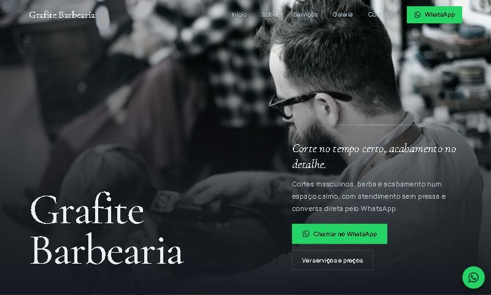

# Grafite Barbearia

Site institucional (landing page) de uma barbearia fictícia, feito com **Laravel, React e Inertia.js**. Apresenta a barbearia, os serviços com preços, uma galeria de fotos, horários, localização e contato por WhatsApp e por formulário.

> **Projeto de portfólio.** Nome, endereço, telefone, preços e textos são ilustrativos. As fotos são do [Unsplash](https://unsplash.com).



## Funcionalidades

- **Página única** com as seções Início, Sobre, Serviços, Galeria e Contato, navegadas pelo menu (com menu próprio no celular).
- **Serviços com preço e duração**, editados num arquivo de dados.
- **Galeria em carrossel** (Swiper), que funciona com arraste, setas e teclado.
- **WhatsApp**: botão flutuante e botões nas seções, com mensagem inicial pronta. O número fica num lugar só.
- **Formulário de contato** enviado por e-mail pelo Laravel, **sem banco de dados**:
  - validação no servidor, com mensagens em português perto de cada campo;
  - telefone aceito com ou sem máscara;
  - proteção contra spam: campo-armadilha e limite de 3 envios a cada 10 minutos por IP;
  - autorização de uso dos dados (LGPD), e nada fica guardado no site.
- **Mapa** do Google Maps, horários de funcionamento e redes sociais.
- **SEO**: título, descrição, Open Graph (prévia ao compartilhar), favicon e HTML semântico.
- **Acessibilidade**: contraste conferido pelo WCAG, foco visível, link "pular para o conteúdo", textos alternativos e respeito à opção de reduzir animações.

## Tecnologias

| Camada | Ferramentas |
| --- | --- |
| Backend | Laravel 13 (PHP 8.3+): rotas, controller, validação e e-mail |
| Integração | Inertia.js (sem API REST separada) |
| Frontend | React 19, Bootstrap 5, CSS3, React Icons, Swiper, AOS, Google Fonts |
| Build | Vite |
| Testes | PHPUnit |
| Execução | Docker (PHP 8.4 + Apache) ou servidor local do Laravel |

## Identidade visual: Arctic Graphite

Uma paleta fria e minimalista, longe do preto com dourado das barbearias tradicionais.

| Cor | Hex | Uso |
| --- | --- | --- |
| Graphite Black | `#15191F` | fundo principal |
| Slate Gray | `#343E4A` | cards e seções secundárias |
| Steel Blue | `#657787` | linhas, ícones e foco |
| Ice Gray | `#B5C3CB` | textos secundários e botão principal |
| Arctic White | `#EAF0F1` | títulos e textos principais |

Tipografia: **Cormorant Garamond** nos títulos e **Manrope** no texto.

## Como rodar

### Com Docker

Precisa só do Docker.

```bash
cp .env.example .env
docker compose run --rm app php artisan key:generate --show
```

Copie a chave que aparecer para `APP_KEY=` no `.env` e suba o site:

```bash
docker compose up -d --build
```

O site abre em http://localhost:8080. Depois de mudar o código, rode o mesmo comando de novo: o `--build` é o que leva o código novo para dentro do container.

### Local

Precisa de PHP 8.3+, Composer e Node.js 20.19+ (ou 22.12+).

```bash
composer setup
```

O comando instala as dependências, cria o `.env`, gera a chave e compila o front. Depois, em dois terminais:

```bash
php artisan serve
```

```bash
npm run dev
```

O site abre em http://localhost:8000.

### Testes

```bash
php artisan test
```

## Onde editar o conteúdo

Os dados não estão espalhados pelos componentes:

| O quê | Arquivo |
| --- | --- |
| Nome, slogan, WhatsApp, telefone, e-mail, endereço, mapa, horários e redes | `resources/js/data/site.js` |
| Serviços, preços e durações | `resources/js/data/services.js` |
| Fotos do Hero, do Sobre e da galeria (com texto alternativo) | `resources/js/data/gallery.js` |
| Título e descrição para buscadores e compartilhamento | `resources/views/app.blade.php` |
| Cores, tipografia e espaçamentos | `resources/css/global.css` |

## E-mail do formulário

Por padrão (`MAIL_MAILER=log`), as mensagens só são gravadas em `storage/logs/laravel.log`. Para enviar de verdade, configure o SMTP do seu provedor no `.env`:

```dotenv
MAIL_MAILER=smtp
MAIL_HOST=smtp.seuprovedor.com
MAIL_PORT=587
MAIL_USERNAME=usuario
MAIL_PASSWORD=senha
MAIL_FROM_ADDRESS="contato@seudominio.com.br"

# Quem recebe as mensagens do formulário
CONTACT_TO="dono@seudominio.com.br"
```

## Estrutura

```
app/
  Http/Controllers/ContactController.php   validação, anti-spam e envio
  Mail/ContatoRecebido.php                 e-mail em texto
resources/
  css/global.css                           identidade Arctic Graphite
  css/app.css                              estilos das seções
  js/Components/                           Header, Hero, About, Services, Gallery,
                                           Contact, WhatsAppButton, Footer…
  js/Layouts/MainLayout.jsx
  js/Pages/Home.jsx
  js/data/                                 conteúdo editável
  views/app.blade.php                      HTML base, SEO e Open Graph
routes/web.php                             GET / e POST /contato
tests/Feature/ContactTest.php              testes do formulário
```
